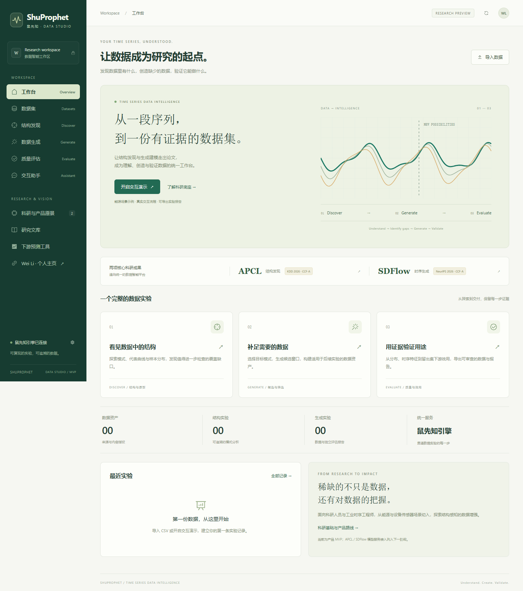

# 鼠先知 ShuProphet · Data Studio

**Understand. Create. Validate.**

面向时间序列的数据智能工作台：理解数据包含的结构，探索需要补足的样本，用可追溯的实验报告验证数据用途。



## 科研基础

| 研究 | 核心问题 | 成果 |
| --- | --- | --- |
| **APCL** | 未知簇数下的时间序列表征与结构发现 | KDD 2026 · CCF-A · [论文](https://dl.acm.org/doi/10.1145/3770855.3817773) · [研究代码](https://github.com/William-Liwei/APCL) |
| **SDFlow** | 相似性驱动的非自回归时间序列生成 | NeurIPS 2026 · CCF-A · [论文](https://arxiv.org/abs/2605.05736) · [研究代码](https://github.com/William-Liwei/SDFlow) |

科研信息与更多工作见 [Wei Li 的个人主页](https://weili.space)。平台围绕两条研究主线持续演进：**Structure discovery → Data synthesis → Quality & utility evaluation**。

## 产品体验

- **Datasets**：导入 CSV、查看数据画像、管理来源与实验记录；内置能源与工业设备模拟示例。
- **Discover**：探索模式分布、二维结构投影与代表曲线，检查数据覆盖。
- **Generate**：选择整体分布或目标模式，生成独立窗口并保存实验配置。
- **Evaluate**：对比留出数据上的分布、时间依赖、频谱、模式覆盖与下游预测效用，检查近邻复制风险。
- **Export**：一起交付数据 CSV、HTML/JSON 质量报告以及包含来源指纹和文件校验值的实验清单。
- **Assistant**：围绕当前数据、模式与质量报告进行交互式解释，附实验来源与下一步操作入口。

对外统一使用 **鼠先知引擎**。当前版本是可交互的产品 MVP；APCL / SDFlow 的模型服务接入和领域验证是下一阶段工作。原型引导生成是持续探索的研究方向。预测作为下游效用评价工具保留。

## 三分钟演示

1. 工作台点击 **开启交互演示**，载入能源模拟数据并自动启动结构发现。
2. 查看模式分布与代表曲线，选择 **扩充此模式** 或 **进入数据生成**。
3. 点击 **生成并验证数据**，完成后打开 **质量报告**。
4. 对比真实、合成和混合训练的下游表现，导出完整数据包。

评估值来自本次实验计算；没有统一的“可信分数”，也不把合成数据直接视为匿名或隐私安全数据。

## 本地启动

公开仓库包含前端和部署材料；后端属于私有交付，不包含在本仓库中。项目所有者将私有 `backend/` 放入根目录后，可运行：

```bash
python scripts/start_local.py
```

需要 Python 3.11、Node.js 22。脚本自动准备环境并构建前端，随后访问 **http://127.0.0.1:8080**。

仅开发公开前端：

```bash
cd frontend
npm ci
npm run dev
```

## 服务器部署

项目所有者在本地构建前端后执行：

```bash
python scripts/package_private.py
```

将生成的私有交付包传到服务器并解压，然后：

```bash
docker compose up --build -d
```

Web 服务与计算服务分开运行，工作区数据持久化保存。部署包不包含本地数据与密钥，也不要将它发布到公共 GitHub Release。

- [部署与访问配置](docs/DEPLOYMENT.md)
- [公开 API 契约](docs/API.md)
- [后端源码边界](BACKEND_NOTICE.md)

## 演进方向

**现在：** 数据实验工作台与完整交互闭环。

**下一阶段：** APCL / SDFlow 接入鼠先知引擎，验证数据适配、模型服务和领域效用。

**持续研究：** 结构感知增强、原型引导生成、更完整的隐私评估与行业约束。

## 许可

公开材料沿用仓库中的 [LICENSE](LICENSE)。新增私有引擎另行交付；历史上已公开的后端代码及其既有授权不因移出当前目录而撤销。
